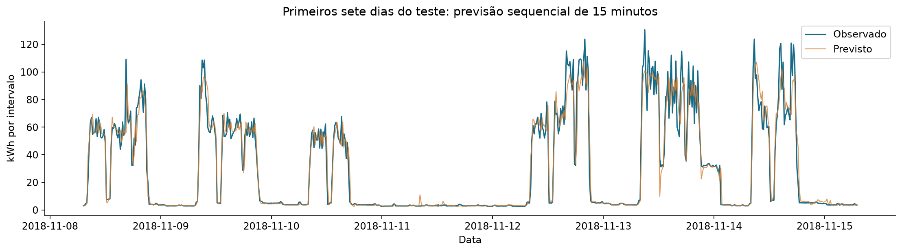

# Previsão do consumo de energia industrial

Atividade N2 de Ciência de Dados: aplicação de análise de dados e aprendizado de máquina à Indústria 4.0.

[](https://colab.research.google.com/github/CodePenguinsCorp/n2-previsao-energia-industrial/blob/main/N2_Previsao_Energia_Industrial.ipynb)

**Instituição:** Católica de Santa Catarina

**Disciplina:** Inteligência Artificial / Ciência de Dados

**Professor:** Claudinei Dias (Ney)

**Integrantes:** Lucas Monich Nunes; José Henrique Brühmüller; André Schultz; Matheus Büsemayer.

## Trabalho principal

Abra **[N2_Previsao_Energia_Industrial.ipynb](N2_Previsao_Energia_Industrial.ipynb)**. O notebook contém a documentação acadêmica completa, o código em Python e as saídas da execução, incluindo gráficos e tabelas.

**Problema:** prever o consumo de uma siderúrgica no próximo intervalo de 15 minutos, usando apenas consumo histórico e calendário conhecido. A previsão é atualizada a cada intervalo; não é uma previsão de um dia inteiro feita antecipadamente.

## Dados e metodologia

- Fonte: [Steel Industry Energy Consumption, UCI](https://archive.ics.uci.edu/dataset/851/steel+industry+energy+consumption).
- 35.040 medições e 11 colunas no CSV original, com frequência de 15 minutos. O arquivo cobre 2018; sob a convenção de encerramento adotada, a última medição é 01/01/2019 00:00.
- As 365 meias-noites ao fim de cada bloco diário recebem +1 dia para preservar a ordem dos registros. Essa hipótese temporal é documentada e verificada no notebook.
- Dados industriais históricos da Coreia do Sul; não são medições coletadas pelo grupo.
- Licença dos dados: [CC BY 4.0](https://creativecommons.org/licenses/by/4.0/), com [atribuição e hash do arquivo](data/README.md).
- Histórico de 15 minutos, uma hora, um dia e uma semana; médias móveis calculadas somente sobre o passado; atributos de calendário.
- Divisão temporal de 70%/15%/15% após excluir 672 linhas sem histórico semanal completo.
- Métodos: persistência, sazonal diário, Ridge e HistGradientBoosting. Seleção por MAE na validação; reajuste do vencedor no conjunto de treino e validação; avaliação final no teste.
- Medições elétricas do próprio intervalo, emissões e categoria de carga são excluídas como preditores, pois sua disponibilidade antecipada não foi demonstrada.

## Resultados da execução

O **HistGradientBoosting** foi escolhido na validação. O teste tem **5.156 intervalos**, de **08/11/2018 07:15** a **01/01/2019 00:00**. Os valores são em kWh por intervalo, exceto R².

| Método | MAE | RMSE | R² |
|---|---:|---:|---:|
| Persistência | 4,9954 | 11,6387 | 0,8615 |
| Sazonal diário | 14,6174 | 26,9966 | 0,2547 |
| HistGradientBoosting | **3,8957** | **7,9050** | **0,9361** |

O vencedor reduziu o MAE em **22,01%** frente à persistência neste teste. Essa é uma redução de erro de previsão, não de consumo ou custo.

Nos 302 intervalos com consumo igual ou superior ao percentil 90 do treino (82,48 kWh), o MAE foi **17,28 kWh**, com tendência de subestimação. Nos demais intervalos, o MAE foi **3,06 kWh**. A qualidade média não garante previsões precisas dos picos.



## Executar no Google Colab

1. Acesse [Google Colab](https://colab.research.google.com/).
2. Abra a opção para enviar um notebook e selecione `N2_Previsao_Energia_Industrial.ipynb`.
3. Execute todas as células em ordem. O notebook baixa o CSV da UCI automaticamente se necessário.
4. Confira as saídas e baixe a pasta `resultados/` para guardar as exportações da sessão.
5. Confira a identificação dos integrantes e revise o texto antes da entrega.

As bibliotecas de análise utilizadas normalmente estão disponíveis no Colab. Caso haja uma dependência ausente, execute em uma célula separada:

```python
%pip install pandas numpy scikit-learn matplotlib joblib
```

## Executar localmente

Em um terminal, na pasta do projeto, com Python 3.10 ou superior:

```powershell
python -m venv .venv
.\.venv\Scripts\python.exe -m pip install -r requirements.txt
.\.venv\Scripts\python.exe -m ipykernel install --user --name energia-n2 --display-name "Energia N2"
```

Abra o notebook no VS Code ou em outro editor com suporte a Jupyter e selecione o kernel **Energia N2**. Execute todas as células. O ambiente exato da execução entregue está registrado em `resultados/metadados.json`; o arquivo `requirements.txt` define faixas compatíveis, sem garantir resultados idênticos entre versões.

## Arquivos

| Arquivo/pasta | Conteúdo |
|---|---|
| `N2_Previsao_Energia_Industrial.ipynb` | Trabalho completo e executável, com resultados salvos. |
| `data/raw/Steel_industry_data.csv` | CSV original, preservado. |
| `data/README.md` | Fonte, licença e integridade dos dados. |
| `resultados/metricas_validacao.csv` | Comparação dos quatro métodos antes da seleção. |
| `resultados/metricas_teste.csv` | Resultado final e referências simples. |
| `resultados/previsoes_teste.csv` | Previsões e erros por intervalo. |
| `resultados/diagnostico_picos.csv` | Erros separados por nível de consumo. |
| `resultados/CONCLUSAO.md` | Síntese gerada com os resultados efetivos. |
| `resultados/metadados.json` | Fonte, auditoria, atributos e versões do ambiente. |
| `resultados/modelo.joblib` | Modelo ajustado em treino e validação, com metadados. |
| `resultados/*.png` | Cinco figuras geradas pelo notebook. |

As exportações são recriadas em cada execução. As medições são históricas e os resultados não comprovam economia financeira ou desempenho em outra fábrica.

## Entrega por link público

O enunciado exige **link público de Colab ou GitHub**. Links do projeto:

- **Repositório:** https://github.com/CodePenguinsCorp/n2-previsao-energia-industrial
- **Notebook para entrega:** https://github.com/CodePenguinsCorp/n2-previsao-energia-industrial/blob/main/N2_Previsao_Energia_Industrial.ipynb
- **Executar no Colab:** https://colab.research.google.com/github/CodePenguinsCorp/n2-previsao-energia-industrial/blob/main/N2_Previsao_Energia_Industrial.ipynb

Confira a identificação dos integrantes antes da entrega. O arquivo publicado no GitHub mantém as saídas executadas, e o link do Colab abre uma cópia para execução.

**Colab:** depois de enviar e revisar o notebook, use **Compartilhar**, habilite visualização para qualquer pessoa com o link e copie a URL. Teste o acesso em uma janela anônima antes de enviar ao professor.

**GitHub:** envie o conteúdo do projeto para um repositório público, preservando a atribuição dos dados. Não envie `.venv/` e `tmp/`. Entregue a URL do notebook ou do repositório e teste o acesso sem estar autenticado.

## Referências

As referências completas estão na seção 6 do notebook. A principal fonte de dados é:

V E, S.; SHIN, C.; CHO, Y. **Steel Industry Energy Consumption** [Dataset]. UCI Machine Learning Repository, 2021. DOI: [10.24432/C52G8C](https://doi.org/10.24432/C52G8C). Acesso em: 27 out. 2026.
